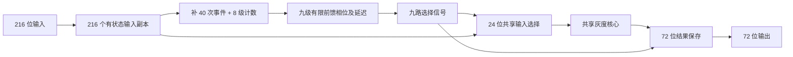

# 3×3 RGB 灰度模型：JKRD V4.0.0

本次按中央 [JKRD](../../../JK/docs/JKRD.md) 重新构造完整模型，共 **677 个节点、306 个有状态位**。先保存全部 216 位输入，再让九个像素依次复用一个 146 节点灰度核心。保持原公式和位序，不增加外部时钟或控制输入。

`Gray = floor((77*R + 150*G + 29*B + 128) / 256)`

核心等价因式分解为 `13*(R+B)+64*R+16*B+150*G+128`，取结果第 8～15 位。这是对 RGB 字节的既定整数公式，不做 gamma 解码。

## 文件

- [完整 V4 模型](rgb-gray-216-72.json)：直接使用标准快照字段、连续数值 Q ID、双 FIFO 和双指纹。
- [独立规格](rgb-gray-216-72.spec.json)：输入输出映射、像素别名、协议、结构角色及执行指标。
- [逐节点优化审查](rgb-gray-216-72.optimization.json)：全部 677 个 EX、小结构预检与整体结构比较。
- [FIFO 验证](rgb-gray-216-72.verification.json)、[RGB 穷举](rgb-gray-216-72.truth-table.json)、[节拍反例与条件改写验证](rgb-gray-216-72.pacing-check.json)。
- [V4 结构校验](rgb-gray-216-72.structure.json)、[四项定向负例](rgb-gray-216-72.negative-tests.json)。
- [绑定所有文件摘要的汇总](rgb-gray-216-72.summary.json)。

## 结构

| 部分 | 数量 | 节点 |
|---|---:|---|
| 全部 RGB 输入副本 | 216 | Q0–Q215 |
| 补事件与到齐计数 | 9 | Q216；Q217–Q224 |
| 像素相位 | 9 | Q225–Q233 |
| 无状态选择信号 | 9 | Q234–Q242 |
| 共享 24 位 RGB 选择 | 24 | Q243–Q266 |
| 共享灰度核心 | 146 | Q267–Q412 |
| 九个灰度结果保存 | 72 | Q413–Q484 |
| 有限前馈延迟 | 192 | Q485–Q676 |
| **合计** | **677** | |



### 保存与输入到齐

`Q0..Q215` 均为有状态输入副本，固定 `Qi = J0K(Xi)`。`i=24*p+8*c+b`；像素 p=0..8 按 L1～L9 行优先排列，c 为 R/G/B，b=0..7 低位在前。旧名称如 `Q0L1R0` 仅作为独立规格中的别名，不写入模型节点 ID。

每个输入副本产生一次直接计数事件，Q0～Q39 还各通过补事件节点产生一次事件，共 216+40=256。八级有状态翻转计数器各在结果为 0 时传播，每两次入事件产生一次出事件；第八级在第 256 次底层事件后才发布一次。每个输入都有正权重，所以在每 Xi 恰一次的协议内，缺任意输入都不能启动计算。初始化没有任务和输出；每帧结束计数器回零。

上层计数器使用 `K(prev)K(prev)K1`，消除来源最新 q 的影响。不能因为来源当次发布了 0 就删掉两个 K：V4 对有状态来源读取的是执行时最新 q。补事件节点初始为 1、每次也恒为 1；底层计数器据此使用已证明的条件改写。

### 九次复用与终止

九个相位节点每帧依次各翻转一次，帧末九位重新相等，下帧直接再次翻转。由相邻相位的异或构造九个无状态选择信号，当前像素的信号为 0，其余为 1。共享 RGB 选择节点据此读取已保存输入；72 个输出保存节点每轮执行，但只有当前像素的八位更新。

输出保存 EX 为 `K(gray)J(inactive)K(gray)`：inactive=0 时写入灰度，inactive=1 时保留旧 q。三个操作在声明的独立输入接口下已通过最短搜索。

核心最大深度为 24，八个轮间间隔各用 24 个前馈延迟节点。业务任务排在同层延迟任务之前；前一轮灰度事件先于后一轮选择事件，输出任务锁存旧选择和旧灰度后才允许选择推进。任务锁存是本结构正确性的必要条件。每间隔少一个延迟的候选已有具体错误反例，见节拍报告。

所有非自身 Q 连接构成 DAG，没有核心完成信号返回相位链的反馈边。第九相位没有下一段，有限任务执行完后自然停止。帧末两队列和所有未收齐集合均为空，补事件节点保持 1，计数器为 0，相位九位相等，输入和结果 q 保留。

## 发送与读取协议

1. 每帧每个 X0..X215 **恰好提交一次**；可任意顺序分批，也可在任务未排空时补充本帧尚未提交的其他位。
2. 缺位时不启动灰度核心、不发布本帧输出；补齐后继续。
3. 全部输入已提交且两条 FIFO 都排空后，读取各 Yi 最后一次事件值；Y(8*p+b) 为像素 p 的灰度位 b。
4. 每个输出位每帧发布九次；中途结果不表示整帧完成。下一帧必须等本帧完成。

计数结构不检查端口去重。同帧重复 Xi 或两帧重叠会破坏事件计数与输入保存协议，不支持把重复输入当作重试。重复的完整帧是支持并已测试的。

## V4 与历史 512 节点方案的差异

历史方案允许核心完成后回触发时钟；现行 V4 要求全部非自身 Q 连接为 DAG，因此本次重新设计前馈调度。历史像素后缀 ID、非输入节点直接引用 Xi、常量启动节点、单 FIFO 和旧快照均不能直接迁移。新模型不套用旧验证报告。

新结构有 677 个节点，历史 512 节点指标不是当前规则下的可直接实现基线。优化目标优先减少节点；当前计数方案只需 9 节点，逐输入桥接屏障需 217 节点，分组计数方案需 25 节点。少节点会增加重复执行的操作量，不能把节点数当成耗时或硬件面积。

| 指标 | 本次实测/核对 |
|---|---:|
| 静态 J/K 操作 | 2763 |
| 初始化执行 | 0 |
| 每帧节点执行 | 3226 |
| 每帧 J/K 操作 | 74163 |
| 每个核心节点每帧执行 | 9 |
| 每个输出位每帧发布 | 9 |
| 所测队列峰值 | 256 |

## 验证与最优性边界

最终落盘模型通过完整 V4 结构校验、双指纹校验、全部 **16,777,216** 种 RGB 核心穷举，以及 **10933 帧**完整 FIFO 功能验证，其中随机帧 10000。验证覆盖黑白灰阶、颜色边界、全部输入单高/单低位、重复帧、分批和非空队列补位、全部 216 种单缺位补齐及复位。每次执行核对来源参数、队列优先级、状态更新、灰度/选择配对和输出事件；每帧核对输入保存、核心九次复用、执行量和空闲状态。

小结构拼接前检查和生成后全节点审查均已执行。核心 134 个 EX 在限定来源接口下证明最短，另 12 个未证明最短。整体比较了系数分解、内联、屏障、共享与层平衡候选；没有全局最少节点或最少执行操作量证明。

安全快照点为所有输入已保存、计数结束、只剩首相位任务等待执行且所有到达集合为空；在此恢复无需补 Xi，实际比较的后续完整执行/传播轨迹相同。V4 标准快照不保存外部 Xi 或未收齐集合，本报告不保证任意中途快照能无损续跑。

本次仅运行新灰度模型相关功能验证，未运行全项目回归或网页 UI 测试，未执行 Git 提交。

## 复现

在项目根目录执行（Node.js 22.12+）：

```sh
node scripts/rgb-gray-v4.mjs
node skills/jk-network-generator/scripts/validate.mjs artifacts/rgb-gray-v4/rgb-gray-216-72.json artifacts/rgb-gray-v4/rgb-gray-216-72.structure.json
node scripts/verify-rgb-gray-v4-core.mjs artifacts/rgb-gray-v4/rgb-gray-216-72.json
node scripts/verify-rgb-gray-v4.mjs artifacts/rgb-gray-v4/rgb-gray-216-72.json --samples 10000
node scripts/rgb-gray-v4-pacing-check.mjs artifacts/rgb-gray-v4/rgb-gray-216-72.pacing-check.json
node scripts/verify-rgb-gray-v4-negatives.mjs
node scripts/summarize-rgb-gray-v4.mjs
```

每次重新生成会产生新的快照身份，需按上述命令重新验证。模型中的完整字段以中央 JKRD 为准，业务说明独立保存于规格文件。
